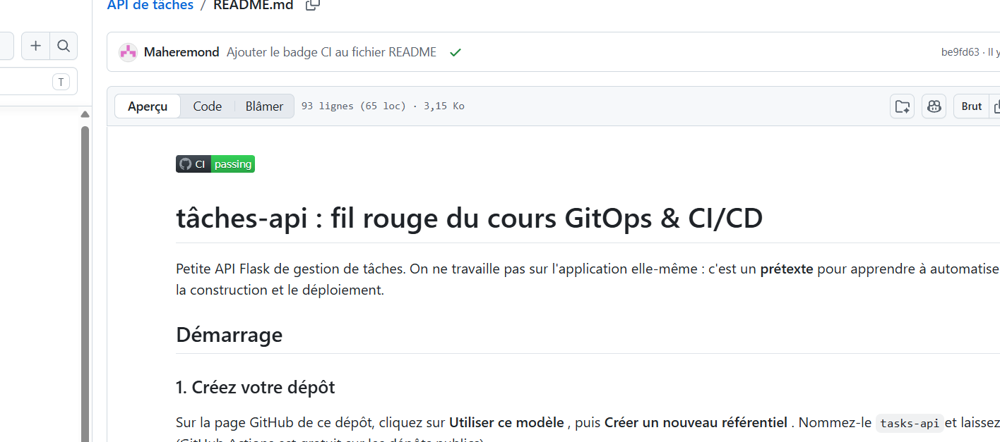
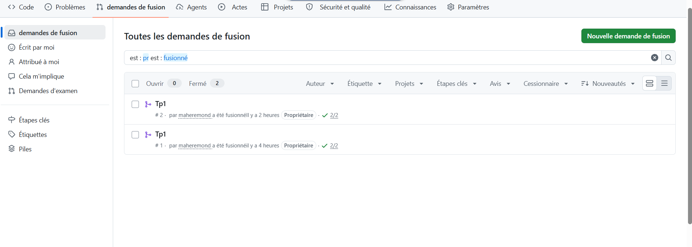
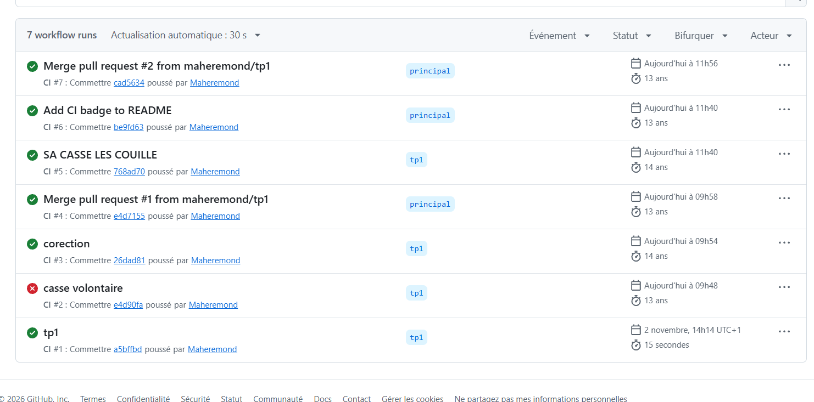
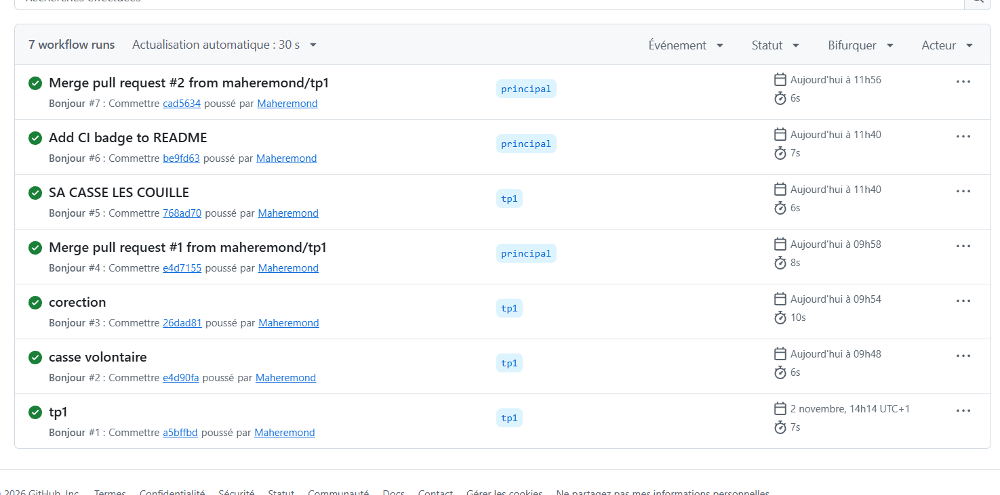

# Dossier de TP — GitOps & CI/CD

> **Brouillon à compléter avant l'export en PDF.** Remplacez les champs entre crochets,
ajoutez vos captures manquantes et personnalisez les réponses avec ce que vous avez réellement fait.
Ne laissez apparaître aucun secret, mot de passe ou jeton dans le PDF.

## Page de garde

**GitOps & CI/CD — Dossier de travaux pratiques**

- Nom : remond
- Prénom : mahe
- Date : 03/11/2026
- Dépôt GitHub : https://github.com/maheremond/task-api

---

## TP1 — Première CI avec GitHub Actions

### Objectif

J'ai configuré GitHub Actions pour lancer un premier workflow à chaque push, puis une CI qui exécute les tests Python. J'ai également provoqué un échec volontaire, observé les logs, corrigé le problème et vérifié la pull request avant sa fusion.

### Captures

1. **TP1-1 — Hello réussi.** [À ajouter : run Hello réussi avec l'étape branche/auteur dépliée.]
2. **TP1-2 — CI réussie.** [À ajouter : run CI réussi avec les étapes visibles.]
3. **TP1-3 — Échec volontaire.** [À ajouter : run rouge avec pytest déplié et erreur lisible.]
4. **TP1-4 — Correction.** [À ajouter : run vert après la correction.]
5. **TP1-5 — Pull request vérifiée.** [À ajouter : PR avant fusion avec les checks verts.]
6. **TP1-6 — Pull request fusionnée.** Capture déjà présente :

   

7. **TP1-7 — Badge CI dans le README.** Capture déjà présente :

   

   La capture des runs Hello ci-dessous montre l'historique et leurs durées, mais pas les logs d'une étape dépliée :

   

   L'aperçu des workflows ci-dessous montre des runs réussis et l'échec volontaire, mais ne remplace pas la capture détaillée TP1-3 :

   

### Réponses aux questions

1. Le run Hello a duré **7 secondes**. Pour voir les logs, j'ouvre le run dans l'onglet **Actions**, puis le job et l'étape concernée. Le run CI a duré **15 secondes** d'après mes notes.
2. Avec `MAX_TITLE_LENGTH = 5`, le test qui échoue est `test_is_valid_title_accepts_normal_title`, dans `tests/test_logic.py`, à la ligne 11. Il attend que `"Faire le TP1"` soit accepté, alors que le titre dépasse désormais la limite. Le nom du test et la ligne d'assertion apparaissent dans la sortie de pytest sur GitHub Actions.
3. On attend une CI verte pour vérifier automatiquement que les tests passent avant la fusion. Cela réduit le risque d'intégrer une régression dans `main`.

### Difficultés rencontrées

mon pc fait des sienne mais j'ai finalement réusit 

---

## TP2 — Une CI solide

### Objectif

L'objectif est d'améliorer la CI avec des contrôles de qualité, plusieurs versions de Python, du cache et un artefact de couverture. Le TP fait aussi pratiquer la protection de `main`, la résolution de conflits et l'utilisation prudente des secrets.

### Captures

1. **TP2-1 — CI verte avec lint et tests.** [À insérer]
2. **TP2-2 — Échec de flake8.** [À insérer]
3. **TP2-3 — Matrice Python 3.11, 3.12 et 3.13.** [À insérer]
4. **TP2-4 — Cache restauré et artefact.** [À insérer]
5. **TP2-5 — Protection de `main`.** [À insérer]
6. **TP2-6 — Fusion bloquée par un check en échec.** [À insérer]
7. **TP2-7 — Conflit dans la PR.** [À insérer]
8. **TP2-8 — Changelog final avec les deux lignes.** [À insérer]
9. **TP2-9 — Secret masqué dans les logs.** [À insérer, sans valeur sensible visible]
10. **TP2-10A — Pipeline A en échec.** [À insérer]
11. **TP2-10B — Pipeline B en échec.** [À insérer]
12. **TP2-10C — Pipeline C en échec.** [À insérer]
13. **TP2-11 — Pipelines réparés.** [À insérer]

### Réponses aux questions

1. **Linter et formateur :** flake8 signale des problèmes de style ou certaines erreurs statiques ; Black reformate le code selon des règles cohérentes. Séparer `lint` et `test` permet de voir rapidement quel type de contrôle échoue et laisse GitHub exécuter les jobs en parallèle.
2. **Matrice, cache et artefact :** tester plusieurs versions détecte les incompatibilités propres à une version de Python. Le cache évite de retélécharger les dépendances à chaque run. Un artefact est un fichier produit par le workflow, conservé pour pouvoir le télécharger ensuite, comme `coverage.xml`.
3. **Protection de `main` :** elle empêche qu'un changement non relu ou dont les vérifications échouent soit intégré directement dans la branche principale.
4. **Conflit Git :** Git signale les modifications concurrentes au même endroit, mais ne peut pas savoir quelle intention fonctionnelle privilégier. Après résolution, la CI relance les contrôles sur le contenu combiné.
5. **Secrets :** GitHub masque les valeurs de secrets dans les logs pour limiter leur divulgation accidentelle. Si un secret est commité, il faut le considérer comme compromis, le révoquer et le remplacer ; le supprimer du fichier ne suffit pas. Un secret sert aux données confidentielles (jeton, mot de passe), une variable aux paramètres non sensibles (par exemple `APP_ENV`).
6. **Pipelines A, B et C :** [À compléter après réparation : pour chaque pipeline, noter le bug observé, le log qui l'a révélé et la correction appliquée. Ne pas deviner sans consulter le run et le fichier concerné.]

### Difficultés rencontrées

[À compléter après le TP : noter le blocage rencontré et comment il a été résolu.]

---

## TP3 — Docker et livraison continue

### Objectif

Le TP consiste à construire et tester une image Docker, puis à la publier dans GHCR par un workflow. Il met aussi en place des versions identifiables, des tests de fumée et une approbation avant le déploiement en production.

### Captures

1. **TP3-1 — Image construite et endpoint `/health`.** [À insérer]
2. **TP3-2 — Docker Compose et endpoint `/version`.** [À insérer]
3. **TP3-3 — Workflow avec tests puis build réussis.** [À insérer]
4. **TP3-4 — Package GHCR avec tag SHA.** [À insérer]
5. **TP3-5 — Tags `0.1.0` et SHA du package.** [À insérer]
6. **TP3-6 — Image GHCR lancée et `/version` répond `0.1.0`.** [À insérer]
7. **TP3-7 — Approbation de production.** [À insérer : montrer l'attente d'approbation et le run terminé, éventuellement en deux images.]
8. **TP3-8 — Identité non-root dans le conteneur.** [À insérer]

### Réponses aux questions

1. Une **image** est le modèle immuable utilisé pour créer des conteneurs ; un **conteneur** est une instance en cours d'exécution de cette image. `.dockerignore` exclut du contexte de construction les fichiers inutiles, volumineux ou sensibles.
2. Docker Compose décrit les paramètres de lancement dans un fichier réutilisable ; une commande unique permet de lancer les services de façon cohérente sans retaper toutes les options.
3. `build` attend la réussite de `test` pour éviter de publier une image d'un code qui échoue aux tests. En production, `latest` est évité parce que ce tag peut pointer vers des contenus différents au fil du temps ; un tag versionné facilite la traçabilité et le retour arrière.
4. Une image versionnée permet d'identifier précisément ce qui est déployé et de reproduire ou restaurer cette version, contrairement à un état local qui peut varier.
5. Un test de fumée vérifie rapidement qu'un service déployé répond sur ses fonctions essentielles. Une approbation humaine avant la production ajoute un contrôle et permet de suspendre un déploiement risqué.
6. Exécuter l'application en root donnerait au processus des privilèges excessifs en cas de compromission. Un utilisateur non-root limite l'impact potentiel.
7. **Étude de cas Trivy :** épingler les actions à une version vérifiée, limiter les permissions du workflow et ne fournir que les secrets strictement nécessaires réduit les risques liés à une dépendance compromise.

### Difficultés rencontrées

[À compléter après le TP : noter notamment les erreurs Docker/registry rencontrées et leur résolution.]

---

## TP4 — GitOps avec Argo CD

### Objectif

Le TP déploie l'application dans un cluster Kubernetes en séparant le code applicatif de la configuration de déploiement. Argo CD observe le dépôt de configuration et réconcilie le cluster pour qu'il corresponde à l'état déclaré dans Git.

### Captures

1. **TP4-1 — Nœud Kubernetes Ready.** [À insérer]
2. **TP4-2 — Pods Argo CD et page de connexion.** [À insérer]
3. **TP4-3 — Application Synced et Healthy avec deux pods.** [À insérer]
4. **TP4-4 — `/version` depuis le cluster.** [À insérer]
5. **TP4-5 — Trois réplicas déclarés et visibles.** [À insérer]
6. **TP4-6a — Pods après le scale manuel à cinq.** [À insérer]
7. **TP4-6b — Pods après la correction automatique.** [À insérer]
8. **TP4-7 — Revert dans `tasks-config` et retour à deux pods.** [À insérer]
9. **TP4-8 — Workflow complet avec `update-config` vert.** [À insérer]
10. **TP4-9 — Mise à jour automatique vers `0.2.0` dans Git et Argo CD.** [À insérer]
11. **TP4-10 — `/version` répond `0.2.0`.** [À insérer]

### Réponses aux questions

1. Un **pod** est la plus petite unité déployable de Kubernetes, qui contient un ou plusieurs conteneurs. Un **Deployment** décrit l'état souhaité des réplicas et gère leur remplacement et leurs mises à jour. Un **namespace** organise les ressources en espaces logiques distincts dans un même cluster.
2. Séparer le dépôt applicatif et le dépôt de configuration permet de faire évoluer et de relire les déploiements indépendamment du code, tout en gardant l'état souhaité dans Git.
3. `selfHeal` signifie qu'Argo CD corrige une dérive du cluster en réappliquant l'état déclaré dans le dépôt. Un retour arrière est simple car Git conserve l'historique et permet de rétablir un commit antérieur avec un revert.
4. **Chemin du tag au pod :** le tag Git déclenche le workflow ; celui-ci teste et construit l'image versionnée, puis la publie dans GHCR. Après approbation, le workflow met à jour le manifeste dans `tasks-config`. Argo CD récupère cette modification et applique l'état demandé au cluster, qui démarre les pods de la nouvelle version. Le workflow pousse les changements de configuration dans Git ; Argo CD tire (pull) l'état depuis Git et le réconcilie dans Kubernetes.
5. Dans un déploiement CI/CD classique, le pipeline pousse souvent directement les changements vers l'environnement. En GitOps, Git contient l'état souhaité et l'agent du cluster le récupère et le réconcilie continuellement.

### Difficultés rencontrées

[À compléter après le TP : noter les difficultés liées à kind, Kubernetes, Argo CD ou aux dépôts Git.]

---

## Bilan

> Proposition à personnaliser en 10 lignes maximum après avoir terminé les quatre TP.

Ces TP m'ont permis de suivre le chemin du code, des tests automatisés jusqu'au déploiement. J'ai retenu l'intérêt des vérifications CI avant une fusion, des images versionnées et d'un état de déploiement déclaré dans Git. La difficulté qui m'a le plus marqué est [à compléter]. Je l'ai résolue en [à compléter]. Pour la suite, je prendrais davantage le temps de [à compléter].

---

## Vérification avant export PDF

- [ ] Remplacer les champs d'identité et personnaliser les réponses.
- [ ] Ajouter toutes les captures TP1 à TP4 demandées et leurs légendes.
- [ ] Compléter les difficultés avec des faits réellement vécus.
- [ ] Vérifier qu'aucun secret ou mot de passe n'est visible.
- [ ] Exporter ce document en un seul PDF nommé `NOM_Prenom_GitOps-CICD.pdf`.
